<p align="center"><b>English</b> · <a href="README.ru.md">Русский</a> · <a href="README.es.md">Español</a> · <a href="README.zh-CN.md">简体中文</a></p>

<p align="center">
  
</p>

<h1 align="center">Calab</h1>

<p align="center">
  All your team’s work in one window: voice rooms, chat, meetings, tasks, wiki, canvas, files, mail and phone calls — in the cloud or on your own server.<br>
  <sub>Voice-first team messenger. macOS · Windows · Linux · Web · phone.</sub>
</p>

<p align="center">
  <a href="LICENSE"></a>
  <a href="https://github.com/itrcz/calab/actions/workflows/ci.yml"></a>
  
  
  
  <a href="https://calab.io/en/"></a>
</p>

<p align="center">
  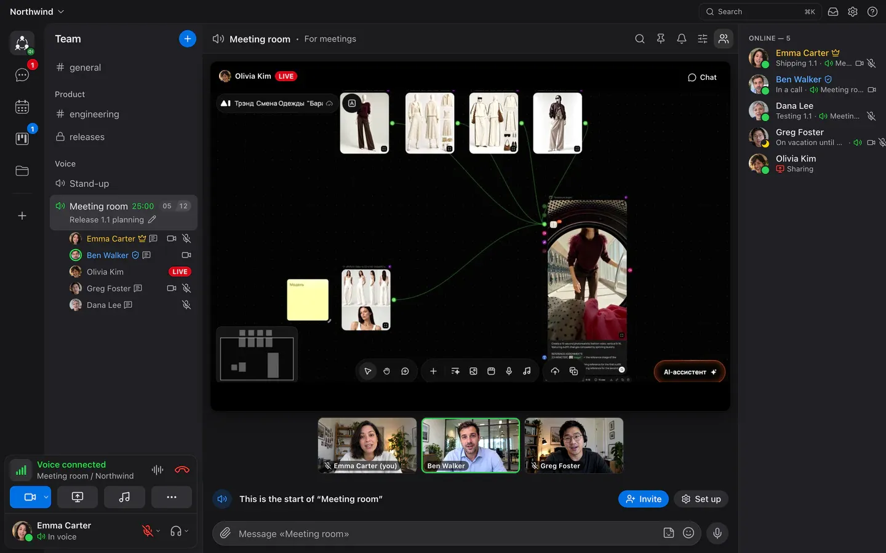
</p>

---

## What it is

Calab puts the whole work of a team in one window: a message becomes a task, the task gets a meeting, the meeting leaves a recording and a transcript, and the outcome lands on a wiki page and on a canvas. Everything links to everything. **Voice** comes first: join a room and you hear your colleagues right away. Calab runs in the cloud or on your own server (one `docker compose`, PostgreSQL and LiveKit inside).

Instead of seven services in seven tabs (messenger, video calls, task tracker, wiki, online whiteboard, file storage, mail and a phone system) there is one rail on the left. The client is light: 0.05 % CPU outside a call and ≈ 7 % in voice on a MacBook Air M4.

**Platforms:** macOS · Windows · Linux · Web · phone (the web app works in a phone browser; iPhone and Android apps are coming soon).

<table>
  <tr>
    <td width="50%"></td>
    <td width="50%"></td>
  </tr>
  <tr>
    <td width="50%"></td>
    <td width="50%">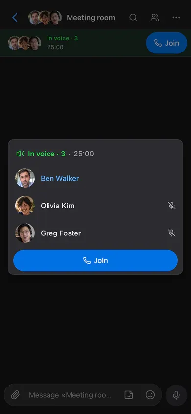</td>
  </tr>
</table>

## Features

### Overview, grouped as on the site

| Group | What is in it |
|---|---|
| Talk | Voice rooms and screen share (pointer and drawing over the stream, noise and echo cancellation), video meetings (up to 25 tiles), chat with replies, reactions and pins, temporary rooms and guests, recording with a transcript |
| Work | Task boards (board, list, timeline; forms, automations, approvals, history), calendar with find-a-time and CalDAV, wiki, canvas (stickies, shapes, arrows, voting, timer), files, mail (desktop app) |
| Order and quiet | `⌘K` search across everything, notification levels per room and task triggers (with forwarding to your own bot), roles and private rooms, web apps pinned in the window |
| AI | Smart task (Business and above), meeting summaries and transcripts, any LLM client as a bot through MCP. An administrator connects a model once in workspace settings; without it AI does not work |
| Telephony | Connect a SIP provider: voice menu (IVR), groups, extensions for people and bots, call transfer, call recordings saved to team files (Business and Enterprise) |
| Self-hosting and control | One `docker compose` on your own server, SSO / Active Directory / roles, open code under BSL 1.1; [docs for developers](https://calab.io/en/docs/) |

### 🎙 Voice and video

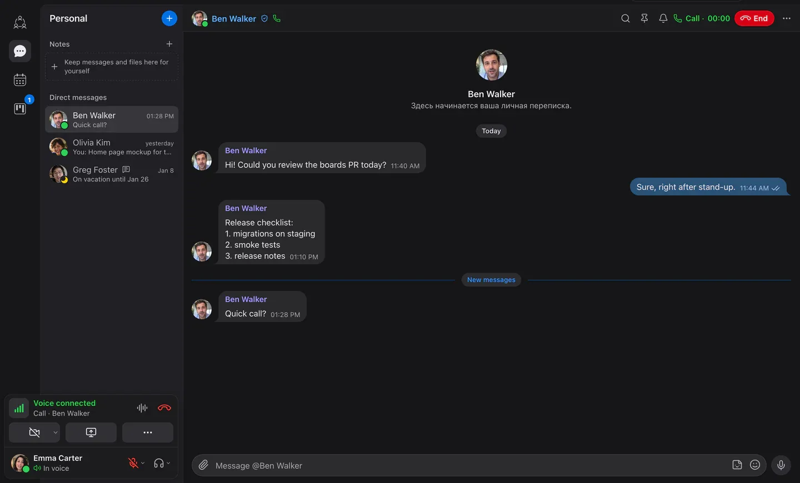

- **Voice rooms** — one click to join; who is talking is visible right in the room list; room status, timer and member limit.
- **Clean sound** — AEC3 echo cancellation and RNNoise noise suppression (no external services), Opus with DTX; voice activation or **push-to-talk** on any key, even in the background.
- **Musician mode** — a personal toggle that turns off echo cancellation, noise suppression and auto gain and switches Opus to a music profile (128 kbps mono / 192 kbps stereo, FEC, no DTX): play an instrument or sing live without the processing eating the sound. Headphones required; others see a guitar icon next to your name. Team and above.
- **Screen sharing** in AV1 or hardware H.264 with simulcast — each viewer gets the quality their connection allows; viewers can point and draw on top of the stream.
- **Camera** with background blur or a picture (built-in and workspace backgrounds).
- **One-on-one calls** in direct messages, with ringing, camera and screen sharing.
- **Meeting recordings** — the server records, GPTunneL transcribes; a card with the summary, audio and full transcript arrives in the room chat.
- **Soundboard**, moderation (server mute, disconnect, move by drag and drop), statuses.
- **Phone calls (SIP)** — connect your own SIP provider and dial a landline or mobile number from a voice room; the callee joins as a participant, everyone sees “Dialling → Ringing → On the call”. Provider settings, a call log, a “Place calls” permission that nobody has by default. Business plan and Enterprise ([ADR-0046](docs/adr/0046-sip-telephony.md)).
- **Temporary rooms** — a room for an hour or a day with a ready guest link and an optional calendar meeting: a Zoom replacement that disappears by itself ([ADR-0044](docs/adr/0044-temp-rooms.md)).
- **Video meeting gallery** — everyone in equal tiles, paged (up to 25 on a large screen), with a Gallery | Speaker switch; speakers are prioritised.

### 💬 Chat

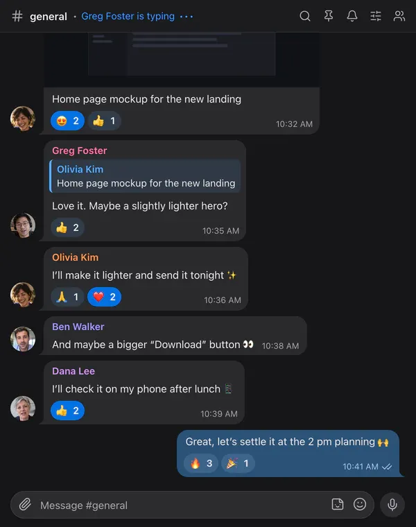

- Bubbles like Telegram: replies, **reactions**, forwarding to several chats, stickers, voice messages, files with previews, pins, read ticks.
- **Mentions**, per-room notifications, workspace search with morphology, `⌘K` quick switcher.
- **Direct messages** with an archive; the web app adapts to phones and installs to the home screen.
- **Search** — `⌘K` finds messages, tasks and their comments, calendar events, files, notes and meeting transcripts, by word start and with typo tolerance.
- **Notifications** — per-room levels; for tasks every kind of event can be switched off separately, and your task notices can be relayed to a bot of your choice (for example into Telegram).

### 📅 Calendar and meetings

<table>
  <tr>
    <td width="50%">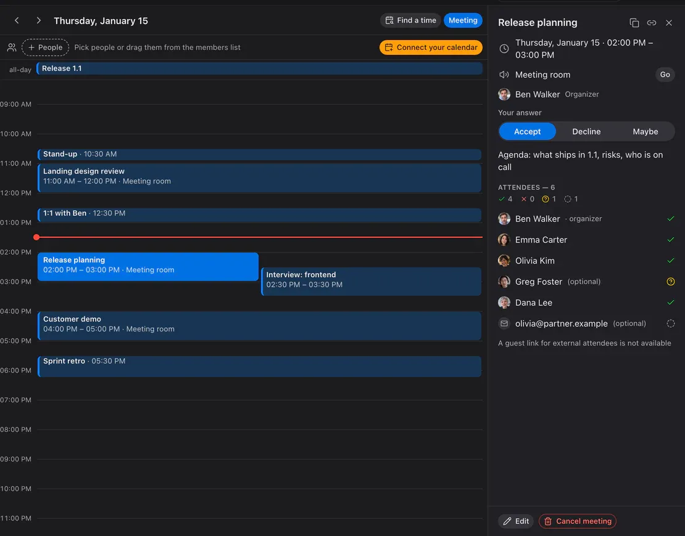</td>
    <td width="50%">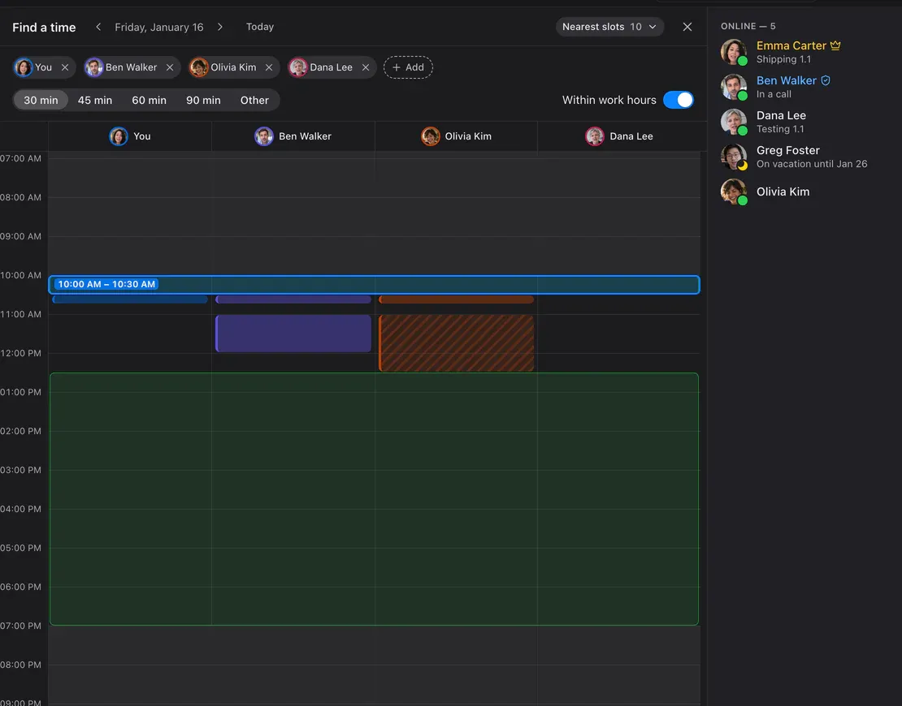</td>
  </tr>
</table>

- A day view with meetings side by side, the meeting card with attendees and answers, the room with a “Go” button, recurring meetings, reminders.
- **Invitations by email** with `invite.ics` — the meeting lands in Apple, Google, Outlook or Yandex calendars; external attendees answer by link and join as guests.
- **Calendar export and subscriptions** (unreleased) — download your meetings as `.ics`, subscribe in Apple Calendar with a button, or scan a QR code from your computer. Personal, read-only links can be replaced or revoked; external apps control refresh timing. [Details](docs/adr/0147-calendar-export-subscription.md).
- **Find a time** — colleagues’ busy columns, shared free windows and the nearest slots within everyone’s work hours.
- **CalDAV** — connect Yandex, iCloud, Fastmail or Nextcloud: your busy time counts, Calab meetings appear there by themselves.

### ✅ Task boards

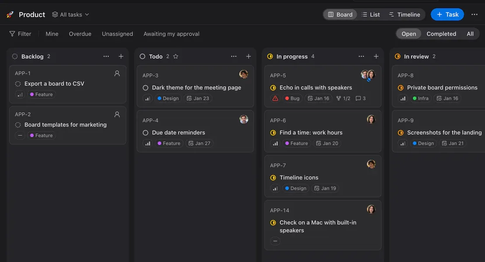

<table>
  <tr>
    <td width="68%">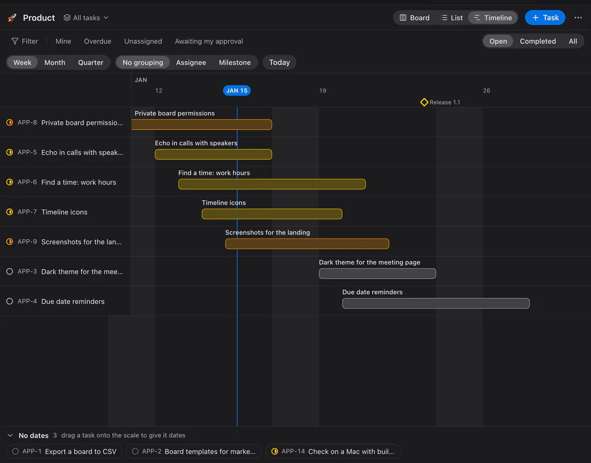</td>
    <td width="32%">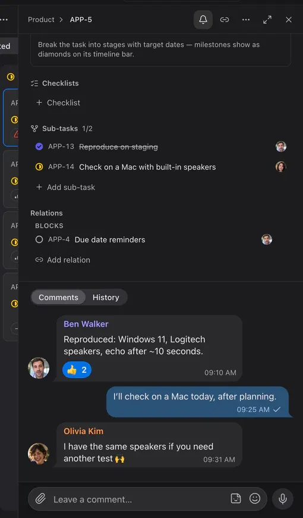</td>
  </tr>
</table>

- **Kanban, list and timeline** (Gantt with milestones and a “today” line), in the spirit of Linear, with its keyboard shortcuts.
- Statuses, priorities, labels, milestones, due dates; several assignees with a lead, subtasks and relations.
- Comments like chat — reactions, stickers, voice messages — mixed with the change history.
- Filters, saved views, bulk actions; **create a task from any message**; a task link unfolds into a card in the chat.

- **Approvals** — assign approvers and how many approvals are needed (all or N of M); a task can’t move on until it is approved ([ADR-0049](docs/adr/0049-task-approvals.md)).
- **Full-screen task** on desktop, as in Linear: `Esc` returns to the board, `↑`/`↓` go to neighbouring tasks.
- **Checklists** inside tasks (Team and above) with progress on the card and “turn an item into a subtask”.
- **Milestones** inside a big task with due dates and progress; they appear as diamonds on the timeline ([ADR-0063](docs/adr/0063-task-milestones.md)).
- **Automations** — “When → If → Then” rules per board: change a status, assign, write to a room and more (Team and above, [ADR-0060](docs/adr/0060-board-automations.md)).
- **Intake forms** — a public link or a private form that creates tasks, with fields, default status and priority (Team 5 per board, Business 20, [ADR-0064](docs/adr/0064-board-forms.md)).
- **Board webhooks** — signed events for your own systems (Business); each board switches its features on and off separately.
- **History** — the “Comments” and “History” tabs: who changed what and when, with before and after values; repeated edits are merged. Watchers, per-task access on closed boards, approval reminders.

### ✉️ Mail

A mail client in the desktop app: connect Gmail, Yandex, Mail.ru or iCloud (an app password is needed), read and send mail without leaving Calab. A message can be forwarded to a chat as text with its attachments. Mail runs locally — passwords stay in the system keychain and the server takes no part; there is no mail in the web or phone app ([ADR-0088](docs/adr/0088-mail-client.md)).

### 📚 Wiki

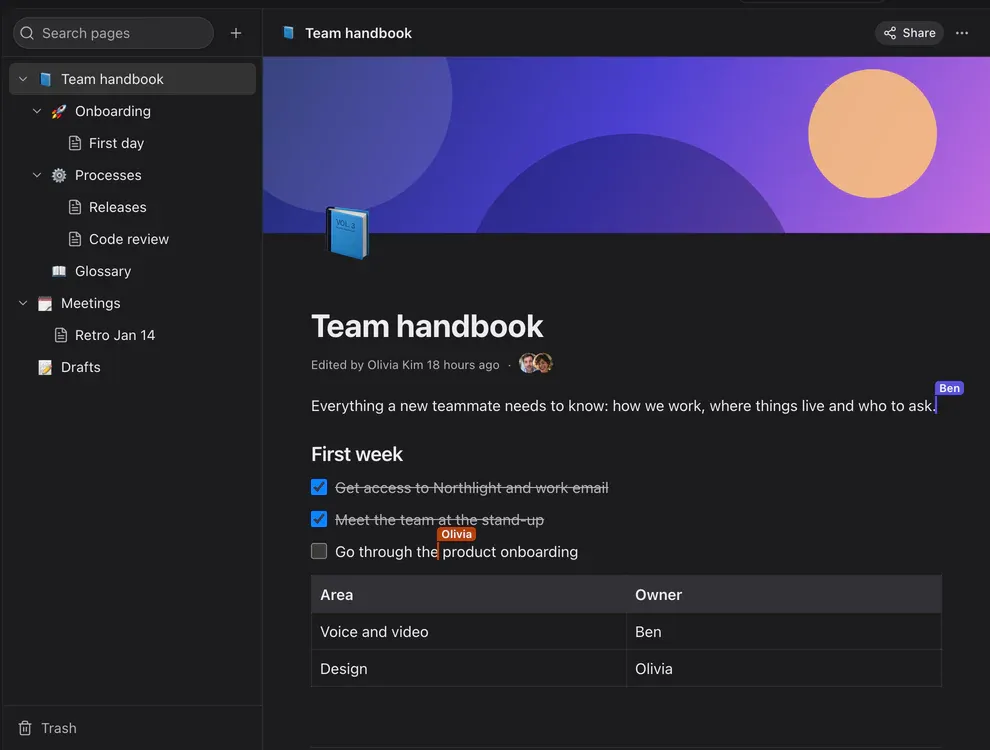

Pages and sub-pages like Notion: a rich editor with tables, checklists, code and images, real-time co-editing with live cursors, version history with restore, access per page and public read-only links. Pages link to each other (`[[`) and a page link in chat unfolds into a card; one menu for the tree row and the page “⋯”: rename, sub-page, move, access, link, versions, export, trash.

### 🗂️ Disk

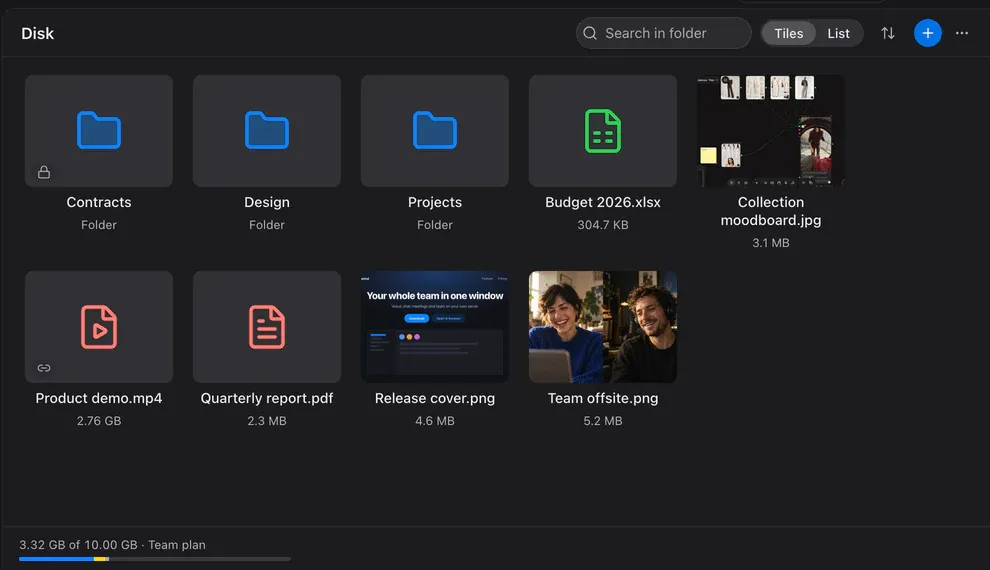

Folders and files of the workspace: drag & drop upload, tiles or list, access per folder (private folders are hidden even from admins), public file links, trash with auto-cleanup and a clear storage meter. The meter shows what takes the space: chats, boards, wiki and the rest.

### 📝 Notes

Up to 20 private shelves with your own names and emoji — like Saved Messages in Telegram, only several. Drag messages and files onto a shelf, forward to it, pin and search.

### 🚪 Guests and approval

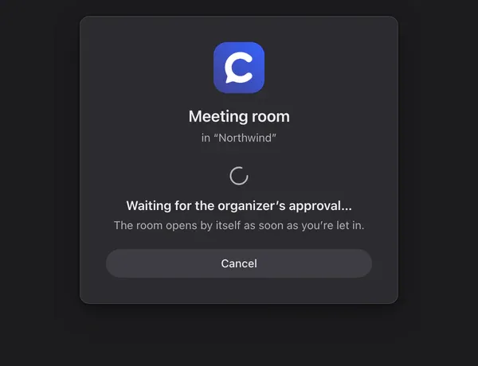

A guest link leads straight into a room — no sign-up. With approval turned on (per room or per link), the guest waits on this screen until the organizer clicks “Let in”. Guests who have not signed in for 48 hours are removed automatically and are grouped separately in the member list. People who left stay in history as “former” members: their messages and tasks remain, and admins see them in a separate tab.

### 🎂 People

- **Profiles** with email and phone (copy in one tap), a unique `@nick` for mentions, status and birthday.
- **Birthdays** — a festive card in chat and a banner in the members panel; **achievements** awarded “for something” with a card in chat and a row in the profile ([ADR-0061](docs/adr/0061-achievements.md)).

### 🧩 Web apps

An admin pins site shortcuts (Grafana, the wiki, the CRM) under the workspace icon in the left rail. A click opens the site full-window inside Calab and the call keeps going; logins are kept separately per app, camera and microphone only with your permission ([ADR-0050](docs/adr/0050-workspace-apps.md)).

### 📱 Phone

The web app adapts to phones and installs to the home screen: Telegram-like room list, swipes (reply, mark read), pinned tabs plus “More”, who is in a voice room at a glance. iPhone and Android apps (calls on the lock screen, push) are coming soon ([ADR-0067](docs/adr/0067-phone-shared-web-host.md)).

### 🤖 Bots and SDK

A bot is a member with a token: the same REST and gateway as the app, rights through roles. It reads and writes chat, answers `/commands`, talks in voice rooms (LiveKit, Node / Python / Go) and works with boards within its rights; events arrive over WebSocket or a webhook with an HMAC signature. Bot API v2 adds the calendar (meetings, free/busy, finding a time), member profiles, invitations, badges, guest admission and meeting recording, plus buttons under messages ([ADR-0051](docs/adr/0051-bot-api-v2.md)).

```ts
import { Bot } from '@calaba/bot-sdk';

const bot = new Bot(process.env.BOT_TOKEN, { server: 'https://app.calab.io' });
bot.on('message', (m) => bot.reply(m, m.content));
await bot.start();
```

SDK — [`packages/bot-sdk`](packages/bot-sdk), examples — [`examples/bots`](examples/bots) (echo, voice echo, TTS, Python), docs — [docs/19-bot-api.en.md](docs/19-bot-api.en.md) · [Русский](docs/19-bot-api.md).

Bots also work with Disk and Wiki (folders, files, pages) and with board webhooks. Developer documentation — bots as an integration API, OAuth 2 / OIDC, SSO: **[calab.io/en/docs/](https://calab.io/en/docs/)**.

### 🔒 Self-hosted and secure

- **Identity 2.0** — workspace-scoped OIDC SSO, LDAPS lifecycle sync and OAuth/OIDC clients for “Sign in with Calab”, with explicit linking, consent and owner recovery. Requires a positive workspace grant plus Business or operator-approved on-prem Enterprise. Keycloak 26.4.7 RP evidence is available; live Entra ID, AD FS and Windows AD compatibility remains unverified. Setup and activation gates: [deployment guide](docs/06-deployment.md#identity-20-настройка-и-приёмка).
- **Works everywhere**: UDP → ICE/TCP → TURN/UDP 443 → TURN/TLS 443 automatically; one public IP; tested behind VPNs.
- Media — DTLS-SRTP; API — HTTPS/WSS, HSTS, strict CSP, argon2id, refresh-token rotation with reuse detection, rate limits. Ordinary web refresh uses `HttpOnly/SameSite=Strict`; identity browser binding, scoped SSO refresh and root authorize resolver cookies use `Secure/HttpOnly/SameSite=Lax` for browser redirects ([cookie contract](docs/plans/release-2.0-identity.md#браузерный-consent-и-cookies)). No end-to-end encryption yet: media goes through your own media server.
- Every right (rooms, boards, calendar) is checked on the server; the LiveKit grant mirrors the rights.
- **Roles by function** — separate rights for boards, members, bots, integrations, journals, events and recordings; private and closed rooms and boards that even administrators can’t see ([ADR-0048](docs/adr/0048-roles-v2.md)).
- **Docker Compose** with hardened containers, automatic Let’s Encrypt certificates, daily backups with verified restore, Prometheus metrics; PostgreSQL 17 or 18.

## Roadmap

Planned, not available yet:

- **Voice AI assistant** — a voice AI assistant in rooms (in testing).
- **IVR** — a voice menu and internal extension numbers for phone calls (SIP).
- **Contact requests for integrations** — coming; not available yet.

## Quick start

### Your own server

You need a Linux host with a public IP, Docker + Compose and a domain with A records for `app`, `rtc`, `turn` (and `@` for the site).

```bash
git clone https://github.com/itrcz/calab.git && cd calab
cp infra/docker/.env.example infra/docker/.env   # DOMAIN, secrets — see the comments
infra/docker/deploy.sh                            # Caddy, LiveKit, API, Postgres, Valkey
```

Ports: `80/443` TCP, `443/UDP`, `7881/TCP`, `7882/UDP`. The first registered user becomes the server owner; everyone else joins by invitation. The full guide, backups and hardening — [docs/06-deployment.md](docs/06-deployment.md).

### The app

Builds for macOS, Windows and Linux are at [calab.io](https://calab.io/en/#download) and on your server at `https://app.<domain>/download/`; the web app is at `https://app.<domain>`. What’s new in each version — [CHANGELOG.md](CHANGELOG.md) (in Russian; the same text goes into [GitHub Releases](https://github.com/itrcz/calab/releases)).

### Development

```bash
corepack enable && pnpm install && make gen       # protobuf → Go + TS
pnpm infra:dev                                    # Postgres, Valkey, LiveKit --dev
cd apps/server && go run ./cmd/server serve       # API on :3000
pnpm -F @calaba/desktop dev                       # Electron
```

Checks: `make lint` from the repository root, `make test` (Go + TS), `make test-integration` with an isolated test environment. Visual suites are disabled by the owner; Identity 2.0 final acceptance commands are in [TESTING.md](TESTING.md#identity-20-final-acceptance). Architecture: [overview](docs/01-architecture.md) · [media](docs/02-media.md) · [network](docs/03-network.md) · [data model and rights](docs/04-data-model.md) · [realtime protocol](docs/05-realtime-protocol.md) · [design system](docs/08-design.md) · [ADR](docs/adr/).

## Plans

| | Free | Team | Business | Enterprise (your own server) |
|---|---|---|---|---|
| Voice room | up to 5 people | up to 15 people | up to 50 people | unlimited |
| Workspace members | up to 50 | up to 100 | up to 500 | unlimited |
| Audio quality | up to “Normal” | any, up to “Excellent” | any | any |
| Screen sharing and camera quality | up to 720p / 15 fps | no quality limits | no quality limits | no quality limits |
| Screen shares at once in a room | 1 | 2 | 5 | unlimited |
| Cameras at once in a room | 3 | 10 | 25 | unlimited |
| Files | 5 GB per workspace | 300 GB per workspace | 1 TB per workspace | unlimited |
| Bots | 1 | 5 | 20 | unlimited |
| Sticker packs | 1 | unlimited | unlimited | unlimited |
| Task boards | 3 | 30 | 50 | unlimited |
| Wiki pages | 10 | 50 | 500 | unlimited |
| Canvases | 3 | 30 | 100 | unlimited |
| Calendar | ✓ | ✓ | ✓ | ✓ |
| CalDAV sync | — | ✓ | ✓ | ✓ |
| Task approvals | ✓ | ✓ | ✓ | ✓ |
| Embedded web apps | ✓ | ✓ | ✓ | ✓ |
| Identity 2.0: SSO / directory / OAuth provider | — | — | positive workspace grant | positive grant + operator workspace allowlist |
| Telephony (SIP) | — | — | ✓ | ✓ |
| White-label | — | — | — | ✓ |
| Support | — | support | priority | — |
| Price | free | on request (**support@calab.io**) | on request (**support@calab.io**) | free for non-commercial use (BSL 1.1, “Powered by GPTunneL”); commercial licence on request |

Free, Team and Business are cloud plans of a workspace ([ADR-0024](docs/adr/0024-plans-and-limits.md)); Enterprise is your own server with no plan limits. CalDAV belongs to a person: it works if any of their workspaces is on Team or above. Details — [calab.io/en/#pricing](https://calab.io/en/#pricing) and [COMMERCIAL-LICENSE.md](COMMERCIAL-LICENSE.md).

**Billing.** A workspace has a balance charged per seat per day; pay by card or SBP (Russia). Paid plans are being enabled workspace by workspace; roles have separate “view / top up / manage” billing permissions, and with the plan inactive a workspace stays readable ([ADR-0080](docs/adr/0080-seat-billing.md)).

## Licence

**Business Source License 1.1** — [LICENSE](LICENSE).

- Non-commercial use (personal, non-profits, education, evaluation up to 30 days) is **free**, with “Powered by GPTunneL” in the interface and the [NOTICE](NOTICE) kept.
- Commercial use — under a GPTunneL licence: [COMMERCIAL-LICENSE.md](COMMERCIAL-LICENSE.md), **support@calab.io**.
- Every version becomes Apache-2.0 four years after its release.

Calab and GPTunneL names and logos are trademarks, see [TRADEMARKS.md](TRADEMARKS.md).

## Contributing and security

Pull requests are welcome with a CLA — [CONTRIBUTING.md](CONTRIBUTING.md). Report vulnerabilities privately to **support@calab.io**, see [SECURITY.md](SECURITY.md).

<p align="center"><sub>© 2026 GPTunneL · Powered by <a href="https://gptunnel.ai">GPTunneL</a></sub></p>
